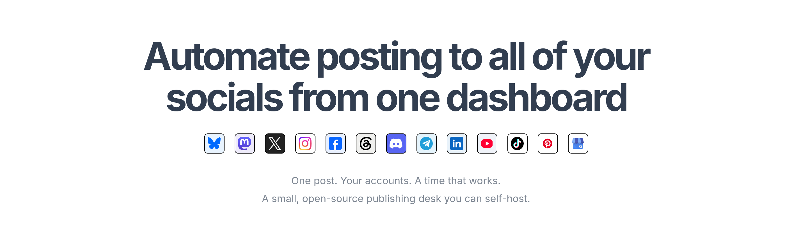

# LightPost

**A lightweight system to automate posting to all of your socials from one dashboard.**

A lightweight, self-hosted social media scheduler. Connect your accounts, write a post, and publish now or schedule it for later—all from one dashboard.



## Features

- **Multi-account publishing:** connect multiple accounts, including several on the same platform, and post to them together.
- **Drafts and scheduling:** save, edit, duplicate, schedule, or publish immediately. Schedule inputs and post times use your browser’s timezone.
- **Per-account content:** choose whether each destination receives text, images, or both, within platform requirements.
- **Images and previews:** import public JPEG URLs, reuse images from Saved Library, add alt text, and preview your content before posting.
- **Delivery tracking:** see individual account results and links to published posts. Retry unsuccessful destinations without repeating successful ones, or cancel further attempts.
- **Persistent queue:** posts survive restarts, overdue schedules resume, and supported media-processing progress is saved.
- **Account management:** verify connections, reconnect credentials, and disconnect accounts.
- **Built-in setup guides:** account eligibility, credential instructions, permissions, and troubleshooting for every platform.
- **Light and dark themes:** follow your device preference or save your own choice.
- **Automation (REST API + MCP):** let scripts, n8n, Claude or other bots create, schedule and publish posts with images. See [Automation](#automation-rest-api-and-mcp).
- **Your data, your server:** encrypted credentials, optional password protection, workspace settings, and post-history exports.

One Python process, SQLite, and plain HTML/CSS/JavaScript. No external database, frontend bundler, or AI dependency. Node.js is only needed for development checks and formatting.

## Supported platforms

| Platform                | Supported posts                                                                            |
| ----------------------- | ------------------------------------------------------------------------------------------ |
| Bluesky                 | Text and up to four images                                                                 |
| Mastodon                | Public text and up to four images                                                          |
| X (Twitter)             | Text and up to four JPEG/PNG images; API cost confirmation before publishing or scheduling |
| Instagram               | One public JPEG with an optional caption; Creator/Business accounts                        |
| Threads                 | Text or one public JPEG                                                                    |
| Discord                 | Server webhook messages and up to four public images                                       |
| LinkedIn                | Public personal-profile posts with text and up to four images                              |
| Telegram                | Public or private channel posts with text and up to four JPEG/PNG images                   |
| Facebook Pages          | Page feed posts with text and up to four JPEG/PNG images                                   |
| TikTok                  | _Under development_                                                                        |
| Pinterest               | _Under development_                                                                        |
| Google Business Profile | _Under development_                                                                        |

Images are limited to **1 MB each**. Use **Add Image** to import a direct public HTTPS JPEG URL. Keep its URL available until delivery completes for Instagram, Threads, and Discord; your server can remain private. Platform-specific limits appear in the composer and Setup Guide. Videos are not supported.

Bring your own authorized platform credentials. API fees, token expiry, permissions, and account eligibility still apply. Initial OAuth consent flows are not included; connect using credentials you obtain from each platform.

## Run locally or on your server

Requires **Python 3.11+ on Linux or macOS**.

```sh
git clone https://github.com/brainstormity/LightPost.git
cd LightPost
python3 -m venv .venv
.venv/bin/python -m pip install -r requirements.txt
.venv/bin/python -m lightpost
```

Open [localhost:3000/app](http://localhost:3000/app), connect an account, and create your first post. New workspaces start empty. Open **Setup Guide** in the sidebar for platform-specific setup.

Keep the app running for scheduled delivery. For automatic startup on Linux, an optional systemd service is provided in [deploy/lightpost.service](deploy/lightpost.service); it expects the app at `/opt/lightpost`, a `lightpost` system user, and a writable `data/` directory.

## Configuration and backups

No `.env` file is required for the default setup. To override settings, copy [.env.example](.env.example) to `.env`. Environment variables take precedence.

| Setting              | Default / purpose                                                                               |
| -------------------- | ----------------------------------------------------------------------------------------------- |
| `HOST`, `PORT`       | `127.0.0.1:3000`                                                                                |
| `DATABASE_PATH`      | `data/lightpost.sqlite`; media and the generated key live alongside it                          |
| `ADMIN_PASSWORD`     | Optional locally; at least 16 characters required when binding beyond loopback                  |
| `ENCRYPTION_KEY`     | Generated automatically if omitted; custom keys must be 64 hexadecimal characters               |
| `COOKIE_SECURE`      | `false`; enable when serving over HTTPS                                                         |
| `API_KEY`            | Optional. Overrides the key LightPost creates for the API and MCP server (24+ characters)       |
| `API_ENABLED`        | `true`; set `false` to switch the API and MCP server off completely                             |
| `PUBLIC_URL`         | Optional https address you provide yourself (proxy or tunnel); empty keeps LightPost local-only |
| `META_GRAPH_VERSION` | `v25.0` for Instagram and Facebook Pages                                                        |

This is a single-owner application. Use a trusted network or HTTPS for remote access. Run one app process per database and keep SQLite on local storage.

For a full backup, stop the app and copy the **entire data directory and `.env`** together. Preserve the encryption key. Post-history exports omit credentials and image files, so they are not full backups. Credentials, databases, and keys are excluded from Git.

An interrupted delivery may need manual review if a platform accepted a post before the connection dropped. Check the destination before retrying; delivery across platforms is not atomic or guaranteed exactly once.

## Automation: REST API and MCP

Scripts, [n8n](https://n8n.io), Claude, or any other bot can create, schedule, edit and publish posts (text and images) without copy-pasting into the dashboard. Everything goes through the same checks as the dashboard, so platform limits, image rules and the X cost confirmation still apply. Posts created this way show up in the dashboard like any other.

### 1. Get your key

There is nothing to set up. LightPost creates a private API key the first time it starts and keeps it in your data folder (`data/api.key`). Open **Settings → Automation** to see it, copy it, copy ready-made connection addresses, turn access off, or create a new key. A new key stops the old one working immediately.

- `.venv/bin/python -m lightpost api-key` prints the key in a terminal.
- Set `API_KEY` in `.env` if you would rather choose your own, and `API_ENABLED=false` to switch the API off completely.

Treat the key like a password: it can post to every connected account.

### 2. Use the REST API

Send the key as `Authorization: Bearer <key>` (an `X-API-Key` header also works). An OpenAPI description is served at `/api/v1/openapi.json`, which many automation and agent tools can import.

| Method and path                  | Purpose                                                          |
| -------------------------------- | ---------------------------------------------------------------- |
| `GET /api/v1/accounts`           | Connected accounts (id, platform, handle)                        |
| `POST /api/v1/posts`             | Create a draft, scheduled or immediate post                      |
| `PUT /api/v1/posts/{id}`         | Change a draft or scheduled post; omitted fields are kept        |
| `GET /api/v1/posts`              | List posts (`?status=scheduled&offset=0`)                        |
| `GET /api/v1/posts/{id}`         | One post with per-account delivery results                       |
| `POST /api/v1/posts/{id}/cancel` | Stop a scheduled post (it returns to draft)                      |
| `POST /api/v1/posts/{id}/retry`  | Retry failed destinations                                        |
| `DELETE /api/v1/posts/{id}`      | Delete a post record                                             |
| `GET/POST /api/v1/media`         | List images, or add one (JSON `url`/`data`, or multipart `file`) |

```
KEY=paste-your-key-here

# Save a draft to Bluesky and LinkedIn (nothing is published)
curl -X POST http://localhost:3000/api/v1/posts \
  -H "Authorization: Bearer $KEY" -H "Content-Type: application/json" \
  -d '{"text": "Hello from my automation", "accounts": ["bluesky", "linkedin"]}'

# Schedule with an image from a URL, in your own timezone
curl -X POST http://localhost:3000/api/v1/posts \
  -H "Authorization: Bearer $KEY" -H "Content-Type: application/json" \
  -d '{"text": "Launch day", "accounts": ["all"],
       "images": [{"url": "https://example.com/launch.jpg", "alt": "The launch banner"}],
       "scheduledAt": "2026-11-02T09:30:00", "timezone": "Asia/Jerusalem"}'
```

Post fields:

| Field            | Meaning                                                                                                                                      |
| ---------------- | -------------------------------------------------------------------------------------------------------------------------------------------- |
| `text`           | Post text (up to 10,000 characters; each platform's own limit applies).                                                                      |
| `accounts`       | Account ids, handles (`@name`), platform names (`bluesky`, `x`, `linkedin`, ...) or `"all"`. A platform name must match exactly one account. |
| `images`         | Up to four items, each `{"url": ...}`, `{"data": "<base64>"}` or `{"mediaId": ...}`, with optional `alt`. JPEG, PNG or WebP, 1 MB each.      |
| `status`         | `draft`, `scheduled` or `now`. **Default: `draft`, or `scheduled` when `scheduledAt` is given**, so nothing is published unless you ask.     |
| `scheduledAt`    | Future ISO 8601 time. Without an offset, `timezone` is used, else the workspace timezone (default UTC); the response says which.             |
| `timezone`       | IANA name such as `Asia/Jerusalem`.                                                                                                          |
| `contentOptions` | Optional per-account text/image switches, like `{"x": {"image": false}}`.                                                                    |
| `xCostConfirmed` | Must be `true` to publish or schedule to X (Twitter), which bills API usage.                                                                 |
| `xAllowLinks`    | Allow links in text posted to X.                                                                                                             |
| `idempotencyKey` | Any unique string. Repeating the request returns the original post instead of posting twice, which makes retries in n8n safe.                |

Unknown fields are rejected, so a typo such as `scheduled_at` can never quietly turn a scheduled post into a draft.

### 3. Connect an AI assistant over MCP

LightPost is an [MCP](https://modelcontextprotocol.io) server at `http://localhost:3000/mcp` (Streamable HTTP, same key). Tools: `list_accounts`, `create_post`, `list_posts`, `get_post`, `cancel_post`, `retry_post`, `delete_post` and `upload_image`. The server tells the assistant to save drafts unless you explicitly ask it to schedule or publish.

```
# Claude Code
claude mcp add --transport http lightpost http://localhost:3000/mcp \
  --header "Authorization: Bearer $KEY"
```

- **n8n:** use the MCP Client node with the address above and a Bearer header, or the HTTP Request node with the REST API.
- **Tools that cannot send headers** (many connector screens only ask for an address) can use the connector address from Settings, `http://localhost:3000/mcp/<key>`, which carries the key inside it. Anyone who sees that address can use your key, so keep it private.
- **Clients that only speak stdio** can use a bridge such as `npx mcp-remote http://localhost:3000/mcp --header "Authorization: Bearer $KEY"`.

### 4. Tools that run on the internet

Step-by-step guides with screenshots are in the app under **Setup Guide → Connect your tools** and in [docs/automation.md](docs/automation.md).

By default LightPost listens only on your own computer and opens nothing to the internet. Claude on the web, Grok bots and cloud n8n cannot reach `localhost`, so if you want them to, choose how in **Settings → Reach it from the internet** (or set `PUBLIC_URL` in `.env`):

| Choice                   | What it does                                                                                                                                                                                                                                                 |
| ------------------------ | ------------------------------------------------------------------------------------------------------------------------------------------------------------------------------------------------------------------------------------------------------------ |
| **Off** (default)        | Local only.                                                                                                                                                                                                                                                  |
| **ngrok**                | LightPost runs the `ngrok` program you installed. Your own setup is used as-is: leave everything empty if ngrok is already configured, or give an authtoken (stored encrypted, never shown again), a static domain, and/or the path to your own `ngrok.yml`. |
| **My own https address** | Tailscale Funnel, a Cloudflare named tunnel, Caddy or nginx on a server you run: point it at `http://127.0.0.1:3000` and enter its public `https://` address. LightPost starts nothing and does not check it; it only shows the addresses for your tools.    |

The choice is saved with your installation and restored when LightPost starts. The panel shows the public MCP, connector and REST addresses to give your tools.

**Authentication for outside requests.** A request that arrives through a public hostname is only served if it is for `/api/v1` or `/mcp` and carries your API key (a bearer header, `X-API-Key`, or the connector address `/mcp/<key>`). Everything else — the dashboard, its settings and its data — is refused with 403 unless you also set `ADMIN_PASSWORD`, in which case the dashboard asks for that password. The key is 256 bits, compared in constant time, and turning API access off in Settings closes these endpoints from outside as well. Your computer must stay on, and whatever carries the traffic (Cloudflare, ngrok, your proxy) can read it, so keep the key private and use **Regenerate** if it leaks.

## Development

```sh
.venv/bin/python -m pip install -r requirements.txt ruff==0.14.2
npm ci
npm test
npm run build
npm run format
.venv/bin/python -m ruff check lightpost tests
```

Tests use temporary databases and mocked platform requests, never real social accounts. `npm run build` checks JavaScript syntax and runs frontend tests; there is no generated frontend to deploy. Run checks locally before pushing. No GitHub Actions workflows are included.

## License

[MIT](LICENSE). LightPost is an independent project and is not affiliated with Post Bridge or the supported platforms. The Instagram gradient glyph comes from [Meta’s official logo pack](https://www.meta.com/brand/resources/instagram/instagram-brand/). Additional logos come from [TikTok’s developer asset pack](https://developers.tiktok.com/doc/getting-started-design-guidelines), [Pinterest’s brand resources](https://business.pinterest.com/brand-guidelines/), and [Google Business Profile](https://business.google.com/us/business-profile/). Platform logos belong to their respective owners and are subject to their brand guidelines.
